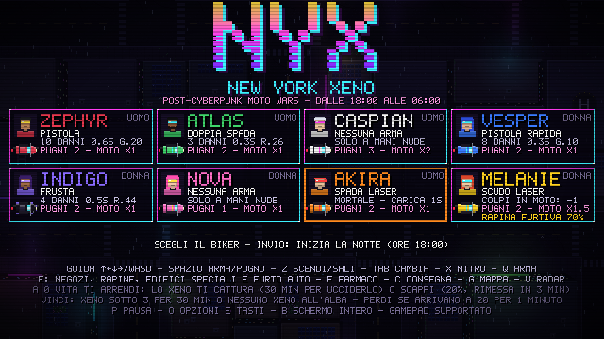
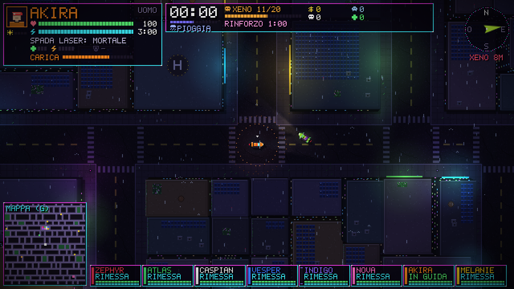
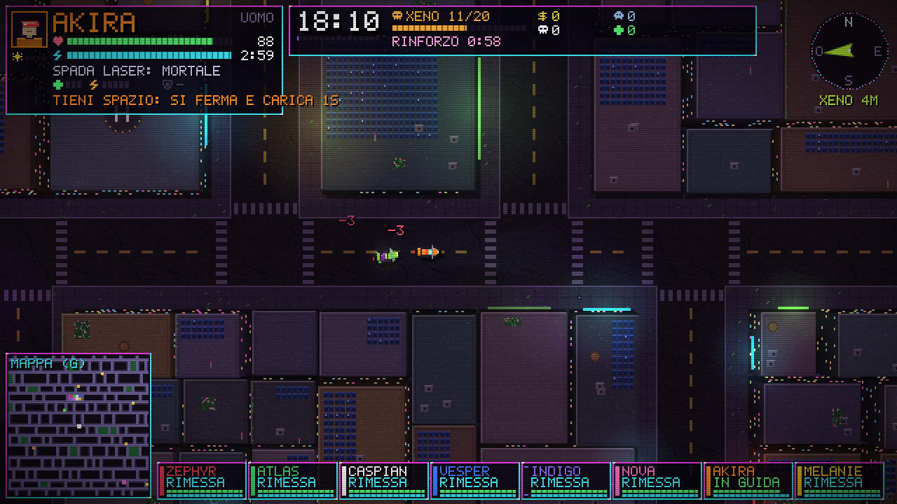

# New York Xeno (NYX)

> **Sono le 18:00. Gli Xeno sono in città. Hai otto biker, una rimessa e dodici ore di buio.**



## La notte è tua. Se riesci a tenerla.

New York è caduta nel neon. Le insegne sfrigolano sotto la pioggia, le sirene tagliano gli incroci
e tra i palazzi corrono gli **Xeno**: motociclisti alieni in tuta acida che vogliono la città entro l'alba.

Tu guidi la **NYX**, l'ultima gang di biker rimasta. Non hai un esercito: hai otto piloti, una rimessa
che ricarica le batterie e una regola sola. **Arrivare vivi alle 06:00.**



### Perché ci perderai la notte

- **Una città nuova a ogni partita.** Isolati, parchi, negozi ed edifici speciali sono generati da zero:
  nessuna notte è uguale alla precedente.
- **Una notte vera, minuto per minuto.** Ogni minuto giocato è un minuto di notte. Il cielo passa dal
  crepuscolo viola al blu della mezzanotte fino al rosa dell'alba, e le strade si illuminano solo di
  fari, lampioni e neon.
- **Pioggia che cambia tutto.** Per metà della notte piove: gocce, spruzzi e insegne riflesse
  sull'asfalto bagnato.
- **Otto biker, otto modi di giocare.** Pistole, doppie spade, frusta, pugni nudi, una moto doppia velocità
  e una dea della notte nascosta. Più due nuovi arrivi (vedi sotto).
- **Batterie solari, non benzina.** Ogni moto si scarica guidando e si ricarica ferma. Decidi tu quando
  correre, quando fermarti e quando passare il comando a un altro biker.
- **Una città che reagisce.** Rapina un negozio e il negoziante risponde. Esagera e arriva la polizia.
  Abbatti gli agenti, ruba la volante e portala in rimessa per incassare.
- **Mille modi di sopravvivere.** Farmacie, meccanici, ospedale, banca con obbligazioni, centro NASA con
  scudi anti-Xeno, chiesa che ferma i rinforzi, armeria, missioni di consegna ogni 15 minuti.
- **Se cadi, non è finita.** A zero vita uno Xeno ti cattura: hai 30 minuti per dargli la caccia
  e liberare il tuo biker.



### I nuovi arrivati

**AKIRA** · *La lama che ferma il tempo.* Moto arancione e spada laser. Tieni premuto l'attacco:
la moto inchioda, la lama si carica per un secondo e poi niente, intorno a lui, resta in piedi.
Un colpo, una strage. Basta sopravvivere a quel secondo.

**MELANIE** · *Non la vedi arrivare. Non la vedi andare via.* Moto gialla, nessuna arma, nessuna paura.
Il suo scudo laser riduce ogni colpo a un graffio (1 di vita) finché resta in sella, la moto corre
una volta e mezza più veloce e le sue rapine passano inosservate 7 volte su 10.

### Pronto in un clic

Niente installazione, niente account, niente download da gigabyte: **un solo file HTML** che gira
offline in qualsiasi browser moderno. Si gioca con tastiera o **gamepad** (grilletti analogici, vibrazione,
simboli Xbox e PlayStation), tasti rimappabili, salvataggio automatico. Grafica pixel-art,
colonna sonora synth generata in tempo reale e opzioni per ridurre i lampeggi.

**Accendi il motore. La città non aspetta.**

---

## Come giocare

- **File unico:** apri `NYX.html` nel browser (funziona offline, basta un doppio clic).
- **Versione a moduli:** apri `index.html` (carica i file in `js/`).

Il salvataggio e le impostazioni restano nel browser.

## Comandi

| Azione | Tastiera (predefinito) | Gamepad (Xbox / PlayStation) |
|---|---|---|
| Accelera / frena | ↑ ↓ oppure W S | RT / LT (R2 / L2), analogici |
| Sterza / cammina | ← → oppure A D | Stick sinistro |
| Attacco / pugno | Spazio | A (✕) |
| Scendi / sali | Z | B (○) |
| Interagisci | E | X (□) |
| Nitro | X | Y (△) |
| Cambia arma / cambia biker | Q / Tab | LB / RB (L1 / R1) |
| Farmaco / consegna farmaci | F / C | Croce ↑ / ↓ |
| Radar negozi / richiama | V / R | Croce ← / → |
| Mappa | G | Select (Share) |
| Pausa | P o Esc | Start (Options) |
| Opzioni e rimappatura | O | Select dalla pausa |
| Schermo intero | B o doppio clic | — |

Tutti i tasti si rimappano da **Opzioni → Rimappa i tasti** (due tasti per azione).
Nelle opzioni ci sono anche volumi, "riduci lampeggi", effetto CRT, scosse della camera e vibrazione.

## Biker

Zephyr, Atlas, Caspian, Vesper, Indigo, Nova e due nuovi:

- **Akira** (moto arancione): spada laser. Tieni premuto l'attacco, la moto si ferma,
  carica per 1 secondo e colpisce tutto intorno con un colpo mortale.
- **Melanie** (moto gialla): nessuna arma. Scudo laser (in moto ogni colpo toglie 1 di vita),
  moto x1.5, rapina furtiva: 70% di possibilità che non ci siano conseguenze.

In armeria due biker qualsiasi, tranne i leader Zephyr e Vesper, possono allenarsi insieme:
+2 danni ad armi e pugni.

## Struttura del codice

| File | Contenuto |
|---|---|
| `js/core.js` | costanti, utilità, font bitmap, testo, icone |
| `js/data.js` | roster dei biker, tipi di negozio |
| `js/city.js` | generazione della città, collisioni, percorsi |
| `js/art.js` | texture, sprite, edifici, rotazioni pre-calcolate |
| `js/audio.js` | effetti, musica, pioggia, volumi |
| `js/input.js` | tastiera rimappabile, gamepad, impostazioni |
| `js/game.js` | stato, salvataggio, squadra, negozi (tabella dati), aggiornamento |
| `js/ai.js` | Xeno e polizia |
| `js/render.js` | mondo, edifici 3D, luci notturne, meteo, segni a terra |
| `js/hud.js` | HUD, menu, titolo, opzioni |
| `js/main.js` | loop a timestep fisso |

Dopo una modifica ai file in `js/` rigenera il file unico:

```bash
node tools/build.js
```
